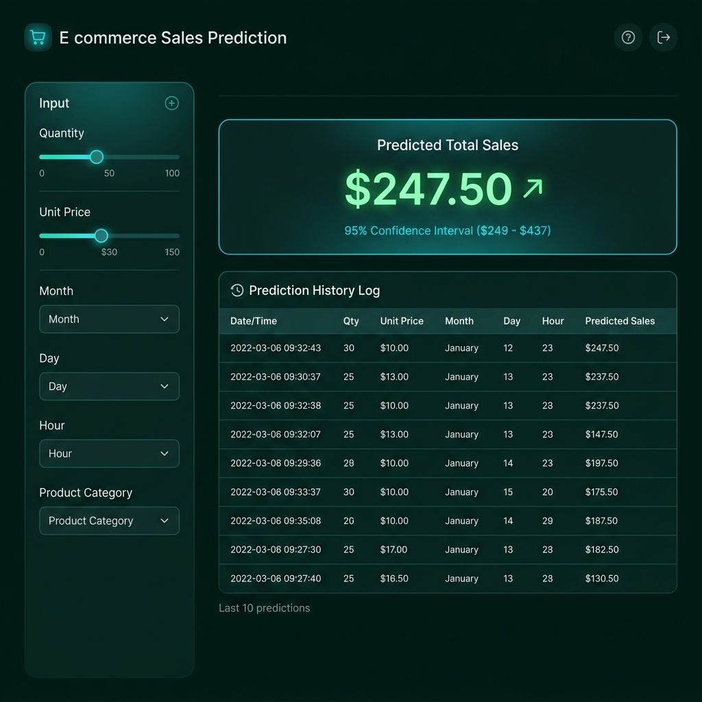
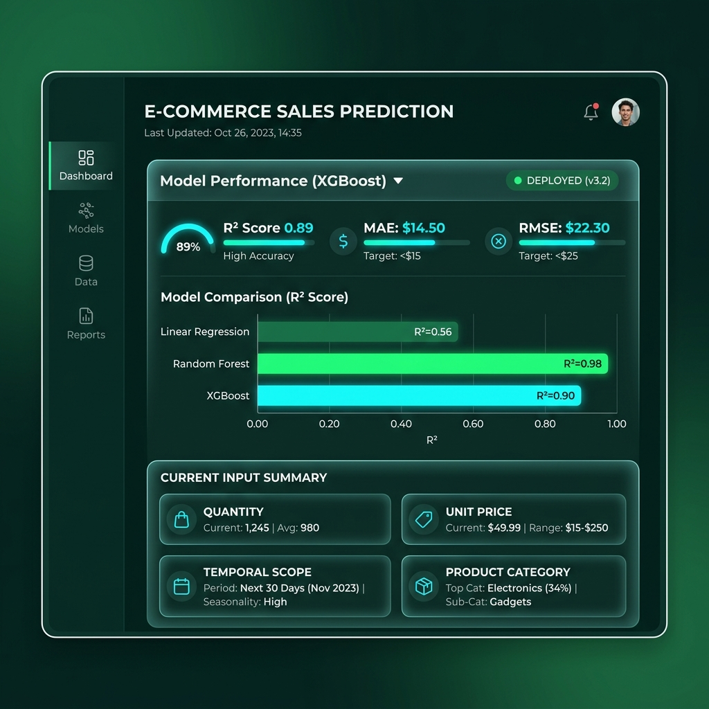

# E-Commerce Sales Prediction

A Streamlit application that predicts the total sales value of a retail transaction from its quantity, unit price, product, and date/time features. The repository includes a trained model, an interactive prediction dashboard, a training and evaluation pipeline, and an exploratory notebook.

## Features

- Predict transaction sales using the saved regression model.
- Enter product, quantity, price, and date/time features in the dashboard.
- Optionally extract a price from a public product page URL.
- Review up to 10 recent predictions in the current Streamlit session and download them as CSV.
- Train and compare Linear Regression, Random Forest, and XGBoost models; save metrics and plots.
- Inspect the included dashboard and model-result screenshots in `assets/`.

The range shown with each prediction is a simple plus/minus 8% estimate; it is not a statistically calibrated confidence interval.

## Screenshots

| Prediction dashboard | Model performance |
| --- | --- |
|  |  |

## Quick start

Requirements: Python 3.10 or later.

```powershell
git clone https://github.com/Abdulahad-web-dev/Ai-sales-prediction.git
cd Ai-sales-prediction
py -m venv .venv
.\.venv\Scripts\Activate.ps1
python -m pip install --upgrade pip
pip install -r requirements.txt
streamlit run app.py
```

Open the local URL printed by Streamlit, usually <http://localhost:8501>. The repository includes model files in `outputs/`, so you can launch the dashboard without first downloading the training dataset.

On macOS or Linux, create and activate the environment with `python3 -m venv .venv` and `source .venv/bin/activate`, then install the requirements and run `streamlit run app.py` as above.

## Train the models

The training pipeline uses the UCI Online Retail dataset. Download and convert it to CSV before running the pipeline:

```powershell
python download_data.py
python convert_to_csv.py
python pipeline.py
```

The data is saved under `data/`, which is excluded from Git. The pipeline cleans the transactions, removes duplicates and invalid quantities/prices, creates `Sales` as `Quantity * UnitPrice`, extracts date/time features, label-encodes product descriptions, and samples up to 50,000 rows for training. It evaluates a random 80/20 train/test split and writes model artifacts and evaluation output under `outputs/`.

The original data source is the [UCI Online Retail dataset](https://archive.ics.uci.edu/dataset/352/online+retail), containing transactions from a UK-based online retailer.

## Evaluation snapshot

These metrics are from the included `outputs/results.csv`; they are a record of one training run, not a guarantee of future performance.

| Model | R² | RMSE | MAE |
| --- | ---: | ---: | ---: |
| Linear Regression | 0.561 | 38.617 | 11.628 |
| Random Forest | 0.987 | 6.711 | 0.477 |
| XGBoost | 0.901 | 18.372 | 9.228 |

The pipeline saves the XGBoost model and label encoder for the app. Metrics can vary when the dataset or training procedure changes.

## Repository layout

```text
app.py                       Streamlit prediction dashboard
pipeline.py                  Data preparation, training, and evaluation
download_data.py             Download the UCI Excel dataset
download_v2.py               Alternate dataset downloader
convert_to_csv.py            Convert the downloaded Excel file to CSV
requirements.txt              Python dependencies
notebooks/sales_prediction.ipynb
assets/                       Screenshots and generated charts
outputs/                      Model, encoder, metrics, and training plots
```

## Notes

- `outputs/best_model_xgb.pkl` and `outputs/label_encoder.pkl` are loaded by the app. If loading fails because of an environment or serialization incompatibility, the app attempts to train a fallback model on synthetic data.
- The optional product URL autofill depends on the target website being publicly reachable and exposing a price in markup the app recognizes; it may not work for every site.
- Training requires the UCI dataset and may take longer than starting the dashboard.
- The included `run_app.bat` references a machine-specific Python environment. Use `streamlit run app.py` from the activated environment for a portable launch.
